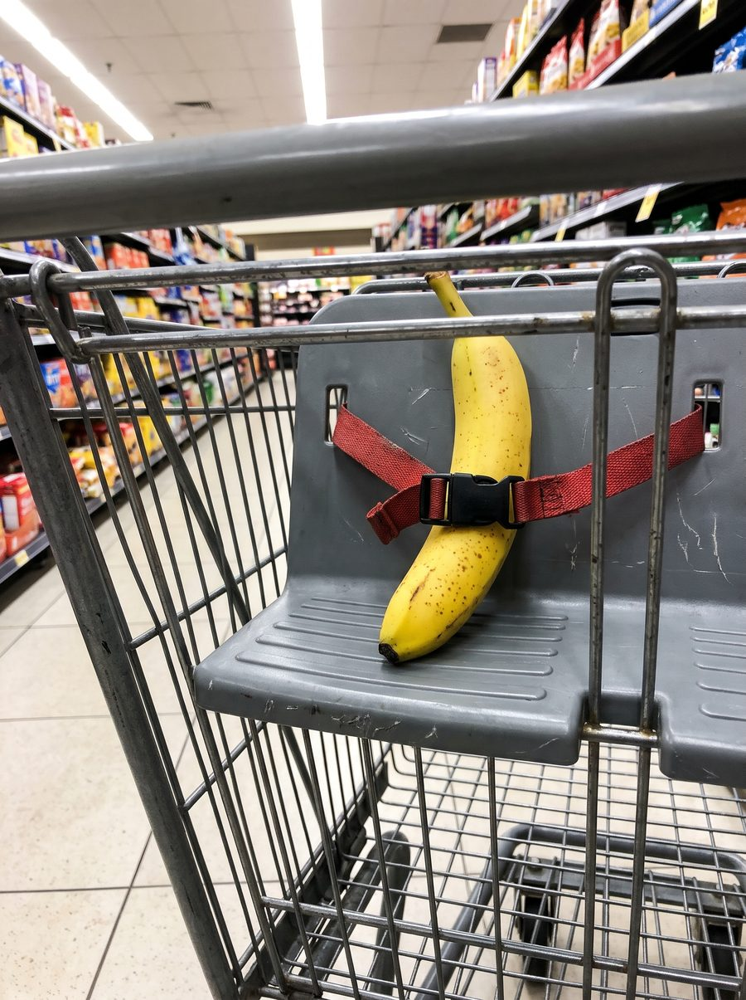
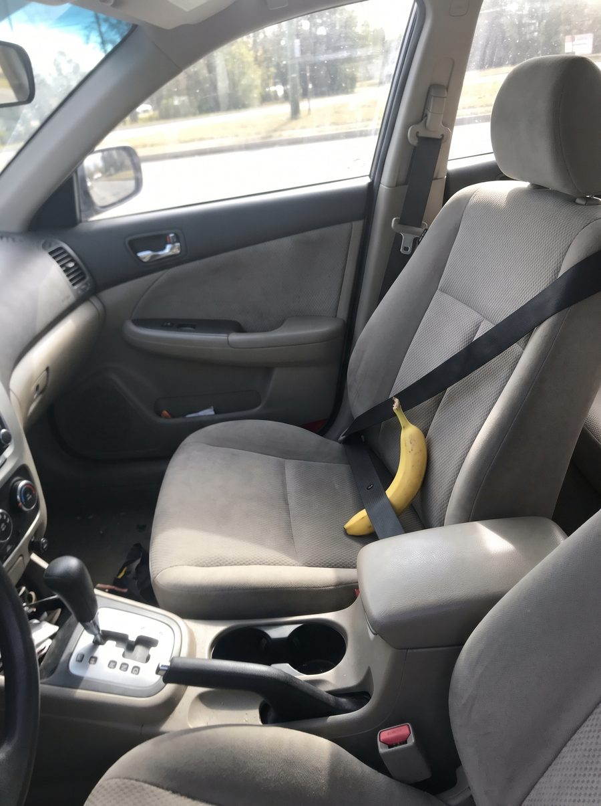
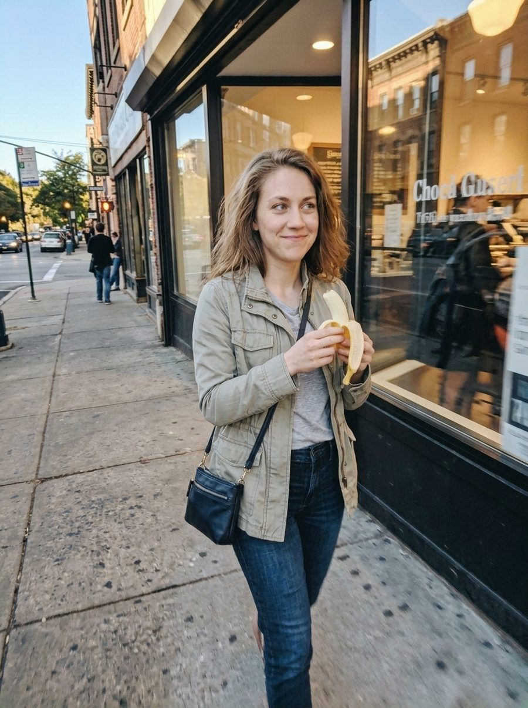
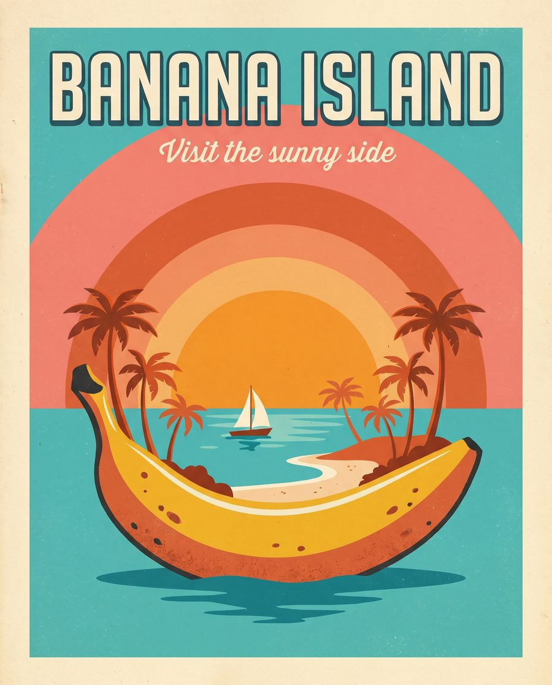
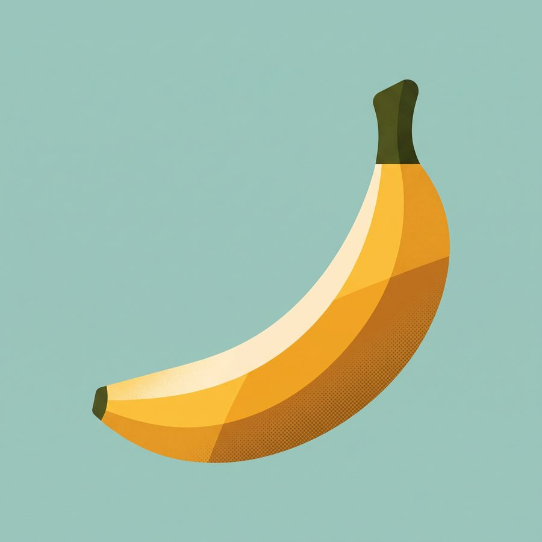

<p align="center">
  
</p>

<h1 align="center">nano-banana</h1>

<p align="center">
  <em>Images from your coding agent, with the bill under control.</em>
</p>

<p align="center">
  <a href="https://github.com/jakubcurik/nano-banana/actions/workflows/tests.yml"></a>
  <a href="https://github.com/jakubcurik/nano-banana/actions/workflows/validate.yml"></a>
  <a href="https://github.com/jakubcurik/nano-banana/releases"></a>
  <a href="LICENSE"></a>
  <a href="https://github.com/jakubcurik/nano-banana/stargazers"></a>
</p>

<p align="center">
  
  <a href="https://agentskills.io"></a>
  
  
</p>

<p align="center">
  <a href="#install">Install</a> &middot;
  <a href="#quick-start">Quick start</a> &middot;
  <a href="#gallery">Gallery</a> &middot;
  <a href="#how-it-works">How it works</a> &middot;
  <a href="#models-and-prices">Models and prices</a> &middot;
  <a href="#faq">FAQ</a>
</p>

<p align="center">
  <sub>English &middot;
  <a href="i18n/README.zh-CN.md">简体中文</a> &middot;
  <a href="i18n/README.es.md">Español</a> &middot;
  <a href="i18n/README.ja.md">日本語</a> &middot;
  <a href="i18n/README.pt-BR.md">Português (Brasil)</a> &middot;
  <a href="i18n/README.de.md">Deutsch</a> &middot;
  <a href="i18n/README.fr.md">Français</a> &middot;
  <a href="i18n/README.ko.md">한국어</a> &middot;
  <a href="i18n/README.cs.md">Čeština</a></sub>
</p>

<p align="center">
  
</p>

nano-banana is an agent skill that lets Claude Code and other coding agents make and edit images with Google's Nano Banana models. It also keeps track of what that costs.

Ask an agent for a hero image and you get one. Ask it to "try a few more variations" and a plain API call can run a dozen 4K generations while you are still looking at the first. Every image is billed, and nothing in the chat tells you how much.

This skill prints the estimated price before each call and the real cost after it, thinking and input tokens included. A run whose estimate is above your limit (0.50 USD unless you set another) stops before anything is sent. It checks your options against what the chosen model supports, so a wrong size or an unsupported thinking level fails on your machine and not at the API. For everything else it gives the agent a short routine: work out what the image is for, get reference photos when the subject has to look like something real, write the prompt in English, and look at the result before calling it done.

<sub>Unofficial. Not affiliated with or endorsed by Google. "Nano Banana" and "Gemini" are Google's names for its image models and API.</sub>

## See it work

<p align="center">
  
</p>

That is a real run of version 1.0. A 2K image on the default model costs about five US cents, and you see the number before the call and again after it. Since 1.1 the cost after the call also counts the thinking and input tokens, so it comes out slightly above the estimate, and the output shows how long the call took.

## Gallery

Apart from the text and the terminal screenshot, every image in this README was made with the skill. Every person, place and object in them is AI-generated. The prompts are in [`assets/prompts`](assets/prompts).

<p align="center">
  
  
  
  <br>
  <sub><b>Phone-style photos.</b> A banana taped to a gallery wall, buckled into a shopping cart and belted into a car seat. Model 2.1, 2K, 3:4, about 5 cents each.</sub>
</p>

<p align="center">
  
  
  <br>
  <sub><b>Edit with <code>--image</code>.</b> A flash photo at night became a sunny afternoon. Everything except the light stayed the same. Model 2.1, 1K, about 3 cents.</sub>
</p>

<p align="center">
  
  <br>
  
  
  <br>
  <sub><b>Graphics.</b> An infographic and a text poster on Model Pro (2K, about 13 cents each), and a flat vector illustration on Model 2.1 (2K, about 5 cents).</sub>
</p>

<p align="center">
  
  
  <br>
  <sub><b>Same mascot, new scenes</b> with <code>--follow-up</code>. Model 2.1, 1K, about 3 cents each.</sub>
</p>

## Install

Claude Code, from the plugin marketplace:

```
/plugin marketplace add jakubcurik/nano-banana
/plugin install nano-banana@nano-banana
```

Any agent that reads `SKILL.md` skills, through [`npx skills`](https://github.com/vercel-labs/skills):

```bash
npx skills add jakubcurik/nano-banana
```

Or copy `skills/nano-banana/` into your agent's skills folder by hand, for example `~/.claude/skills/` for Claude Code or `~/.agents/skills/` for Codex, Gemini CLI and Cursor.

You also need:

- [`uv`](https://docs.astral.sh/uv/), which fetches `google-genai` and Python 3.11+ on its own. Without it, install Python 3.11+ and `pip install "google-genai>=3.6,<4"`.
- A Gemini API key from [Google AI Studio](https://aistudio.google.com/apikey), with billing turned on. The image models have no free tier.

Give the script the key through the environment, or save it once outside any repository:

```bash
export GEMINI_API_KEY="your-key"
# or
mkdir -p ~/.config/nano-banana && printf '%s' "your-key" > ~/.config/nano-banana/api-key
```

## Quick start

Ask your agent: "make a hero image for my coffee shop site, 16:9", "remove the car from this photo", "combine these two photos". The skill triggers on its own. It asks what the image is for, writes the prompt, tells you the price when it is not trivial, runs the script and checks the result.

You can also call the script yourself:

```bash
S=skills/nano-banana/scripts/generate.py

uv run --script $S "A flat illustration of a red apple on a white table" --estimate
uv run --script $S "A flat illustration of a red apple on a white table" -a 16:9 -s 2K --format jpeg
uv run --script $S "Make the apple green. Keep everything else the same." --follow-up
uv run --script $S "Put this product on a marble table" -i product.jpg -m pro -s 2K
uv run --script $S "A banner with the text \"Open daily\"" --batch -n 4 --currency EUR
uv run --script $S --batch-result
uv run --script $S "Same scene at dusk. Keep everything else the same." --follow-up .cache/nano-banana/20261128-101500-a-flat-illustration-2.png

F=skills/nano-banana/scripts/finish.py
uv run --script $F .cache/nano-banana/hero.png --size 1200x630 --format webp
uv run --script $F .cache/nano-banana/icon.png --transparent
```

Images land in `.cache/nano-banana/`, each next to a `.txt` file with the prompt, the options, the interaction ID, how long the call took and what it cost. The folder gets its own `.gitignore`, so nothing in it ends up in git.

A batch job waits at most 8 minutes (`--wait`), then the script exits and tells you how to collect it. `--batch-result` saves the images once the job is done; running it again does not duplicate them.

<details>
<summary>All options</summary>

| Option | Meaning |
|---|---|
| `-m 2.1 / 2 / pro / lite` | model, default `2.1` |
| `-s 512 / 1K / 2K / 4K` | resolution, default `1K` (512 only on model `2`) |
| `-a 16:9` | aspect ratio: 1:1, 2:3, 3:2, 3:4, 4:3, 4:5, 5:4, 9:16, 16:9, 21:9; also 1:4, 4:1, 1:8, 8:1 on 2.1 and 2 |
| `-i photo.jpg` | input image for editing or as a reference, repeatable, max 14 |
| `-t minimal / medium / high` | thinking level, depends on the model |
| `--search` | Google Search grounding, including image search (not on `lite`) |
| `--follow-up [IMAGE or ID]` | continue from the last result, from a picked image (its `.txt` holds the ID), or from a given interaction |
| `-n 4` | number of images, each billed separately |
| `-o folder` | output folder |
| `--name hero` | file-name stem instead of the start of the prompt |
| `--format png / jpeg` | output file format |
| `--prompt-file file` | read the prompt from a file |
| `--no-store` | ask Google not to keep the interaction (this disables follow-ups on it) |
| `--delete IMAGE or ID` | delete a stored interaction at Google |
| `--batch` | half price, up to 24 h (models 2.1 and lite) |
| `--wait 8` | minutes to wait for a batch job before exiting, `0` to submit and exit |
| `--batch-result [JOB]` | collect a batch job, by default the last one submitted into the output folder |
| `--estimate` | print the price estimate and stop |
| `--max-cost 0.50` | stop before the call when the estimate is above this many USD |
| `--currency CZK` | also show prices in this currency (rate from the Czech National Bank) |

`--currency` and `--max-cost` can also come from `NANO_BANANA_CURRENCY` and `NANO_BANANA_MAX_COST`, or from `~/.config/nano-banana/config.json` (`{"currency": "EUR", "max_cost": 1}`). The command line wins, then the environment, then the file.

`finish.py` takes `--size WxH` (cover fit and crop, `--keep` picks the part that stays), `--format webp / avif / jpeg / png`, `--quality` and `--transparent [COLOR]`.

</details>

## How it works

The skill makes the agent work in a fixed order. It first works out what the image is for, from your request and your project, and asks only about what is missing. If the picture has to show a real species, product or place, it gets two or three reference photos and asks you to confirm them. Then it writes the prompt in English and estimates the price. Above 0.50 USD the script itself refuses to run, and the agent raises the limit only after you agree; it also asks before more than four images. After generating, it looks at the result, fixes small things with a follow-up instead of starting over, and can crop and convert the image for the page it is meant for.

The full workflow is in [`SKILL.md`](skills/nano-banana/SKILL.md). Prompt templates, edit templates and a list of common mistakes are in [`references/prompting.md`](skills/nano-banana/references/prompting.md).

## Models and prices

Snapshot from 28 November 2026, USD per image. Thinking and input tokens come on top, usually less than a cent per image.

| Model | Best for | 1K | 2K | 4K |
|---|---|---|---|---|
| `2.1` (`gemini-nano-banana-2.1`) | almost everything | 0.034 | 0.050 | 0.113 |
| `2` (`gemini-3.1-flash-image`) | 512 px; deprecated by Google, no shutdown date yet | 0.067 | 0.101 | 0.151 |
| `pro` (`gemini-3-pro-image`) | the hardest prompts, a lot of text | 0.134 | 0.134 | 0.240 |
| `lite` (`gemini-3.1-flash-lite-image`) | many simple images, 1K only, no search | 0.034 | n/a | n/a |

Prices and model data live in [`models.json`](skills/nano-banana/scripts/models.json), the one file the script reads when Google changes its [price list](https://ai.google.dev/gemini-api/docs/pricing); a test fails when the tables here and in `SKILL.md` no longer match it. `--search` is billed on top: 5,000 grounded prompts per month are free, then 14 USD per 1,000 search queries.

## Good to know

- Google stores interactions so follow-ups work: 55 days on paid projects, 1 day on the free tier. Use `--no-store` for sensitive photos, or remove one afterwards with `--delete`.
- Every generated image carries an invisible SynthID watermark.
- The model invents details. When a picture has to match a real species, product or building, give it 2-3 reference photos with `-i`. The skill's workflow insists on that.
- After an error the script says whether a retry is safe. A rejected request (4xx, such as a wrong option, a missing key or a quota) was not billed. A server error or a timeout may have been, so it never retries on its own.
- A generation takes roughly 10-30 seconds. An agent whose shell call times out loses an image it has paid for, so the skill tells it to allow enough time or run long jobs in the background.
- `finish.py --transparent` removes one flat background color. Soft shadows and gradients stay, and the model's own transparent output is untested, so ask for a plain background and check the edges.
- If you publish output made with `--search`, Google requires showing its search suggestions. The script saves them next to the image.

## FAQ

**Google has its own `gemini-api` CLI. Why use this?**
The CLI makes the call, and it does that well. This skill adds what sits around the call. You may want both.

| | Google `gemini-api` CLI and skills | nano-banana |
|---|---|---|
| Price estimate before, real cost after | no | yes |
| Expensive runs stop until you raise the limit | no | yes (`--max-cost`) |
| Says whether a failed call may have been billed | no | yes |
| Options checked against the model | no, the API rejects them | yes |
| Follow-up edits without copying IDs | manual | `--follow-up` |
| Prompt and options saved next to each image | no | yes |
| Batch results collectable in a later run | no | `--batch-result` |
| Crop, convert and cut out for the web | no | `finish.py` |
| Prompting guide and templates | no | yes |

The CLI is a beta that moves quickly, so check both before you choose.

**Does it work outside Claude Code?**
The skill follows the open [Agent Skills](https://agentskills.io) format, so other agents that load `SKILL.md` files can use it. I have tested it in Claude Code only.

**Prices changed. What do I edit?**
`skills/nano-banana/scripts/models.json`, and the tables in `SKILL.md`, here and in the translations. The tests tell you if one of them is left behind.

**Why does it ask for reference photos?**
Without one, the model fills in the details of a real thing from its imagination, and the result looks plausible and wrong.

## Contributing

Issues and pull requests are welcome, especially when Google changes models, prices or the API. Update `models.json` and the tables in `SKILL.md` and this README together. The translations in `i18n/` were made with the help of AI, and corrections are welcome.

The offline tests need no API key and no network (the `finish.py` tests run when Pillow is installed and are skipped otherwise):

```bash
python -m unittest discover -s tests
```

## License

[MIT](LICENSE)
