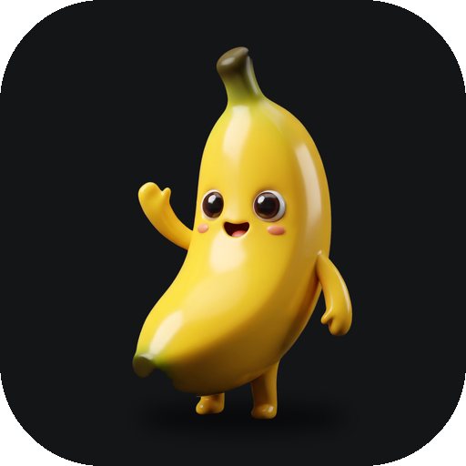

<p align="center">
  
</p>

<h1 align="center">nano-banana</h1>

<p align="center">
  <em>Bilder von deinem Coding-Agenten, mit Kontrolle über die Kosten.</em>
</p>

<p align="center">
  <a href="https://github.com/jakubcurik/nano-banana/actions/workflows/tests.yml"></a>
  <a href="https://github.com/jakubcurik/nano-banana/actions/workflows/validate.yml"></a>
  <a href="https://github.com/jakubcurik/nano-banana/releases"></a>
  <a href="../LICENSE"></a>
  <a href="https://github.com/jakubcurik/nano-banana/stargazers"></a>
</p>

<p align="center">
  
  <a href="https://agentskills.io"></a>
  
  
</p>

<p align="center">
  <a href="#install">Installation</a> &middot;
  <a href="#quick-start">Schnellstart</a> &middot;
  <a href="#gallery">Galerie</a> &middot;
  <a href="#how-it-works">So funktioniert es</a> &middot;
  <a href="#models-and-prices">Modelle und Preise</a> &middot;
  <a href="#faq">FAQ</a>
</p>

<p align="center">
  <sub><a href="../README.md">English</a> &middot;
  <a href="README.zh-CN.md">简体中文</a> &middot;
  <a href="README.es.md">Español</a> &middot;
  <a href="README.ja.md">日本語</a> &middot;
  <a href="README.pt-BR.md">Português (Brasil)</a> &middot;
  Deutsch &middot;
  <a href="README.fr.md">Français</a> &middot;
  <a href="README.ko.md">한국어</a> &middot;
  <a href="README.cs.md">Čeština</a></sub>
</p>

<p align="center">
  
</p>

nano-banana ist ein Agent Skill, mit dem Claude Code und andere Coding-Agenten Bilder mit Googles Modellen Nano Banana erstellen und bearbeiten. Er behält außerdem im Blick, was das kostet.

Wenn du einen Agenten um ein Hero-Bild bittest, bekommst du eins. Sagst du aber „probier noch ein paar Varianten“, kann ein einfacher API-Aufruf ein Dutzend 4K-Generierungen starten, während du noch das erste Ergebnis ansiehst. Jedes Bild wird berechnet, und im Chat steht nirgends, wie viel.

Dieser Skill gibt vor jedem Aufruf den geschätzten Preis aus und danach die tatsächlichen Kosten. Er prüft deine Optionen gegen das, was das gewählte Modell unterstützt, sodass eine falsche Größe oder eine nicht unterstützte Thinking-Stufe auf deinem Rechner scheitert und nicht erst bei der API. Dazu gibt er dem Agenten eine kurze Routine: fragen, wofür das Bild gedacht ist, Referenzfotos besorgen, wenn das Motiv wie etwas Reales aussehen muss, den Prompt auf Englisch schreiben und sich das Ergebnis ansehen, bevor er es für fertig erklärt.

<sub>Inoffiziell. Nicht mit Google verbunden und nicht von Google unterstützt. „Nano Banana“ und „Gemini“ sind Googles Namen für seine Bildmodelle und die API.</sub>

## So sieht es aus

<p align="center">
  
</p>

Das ist ein echter Lauf. Ein 2K-Bild mit dem Standardmodell kostet etwa fünf US-Cent, und du siehst die Zahl vor dem Aufruf und noch einmal danach.

<a id="gallery"></a>

## Galerie

Bis auf den Text und den Terminal-Screenshot ist jedes Bild in diesem README mit dem Skill entstanden. Alle Personen, Orte und Gegenstände darauf sind KI-generiert. Die Prompts findest du unter [`assets/prompts`](../assets/prompts).

<p align="center">
  
  
  
  <br>
  <sub><b>Fotos im Handy-Look.</b> Eine Banane, die an eine Galeriewand geklebt, in einen Einkaufswagen geschnallt und im Auto angegurtet ist. Model 2.1, 2K, 3:4, etwa 5 Cent pro Bild.</sub>
</p>

<p align="center">
  
  
  <br>
  <sub><b>Bearbeiten mit <code>--image</code>.</b> Aus einem nächtlichen Blitzfoto wurde ein sonniger Nachmittag. Bis auf das Licht blieb alles gleich. Model 2.1, 1K, etwa 3 Cent.</sub>
</p>

<p align="center">
  
  <br>
  
  
  <br>
  <sub><b>Grafiken.</b> Eine Infografik und ein Textposter mit Model Pro (2K, etwa 13 Cent pro Stück) sowie eine flache Vektorillustration mit Model 2.1 (2K, etwa 5 Cent).</sub>
</p>

<p align="center">
  
  
  <br>
  <sub><b>Dasselbe Maskottchen in neuen Szenen</b> mit <code>--follow-up</code>. Model 2.1, 1K, etwa 3 Cent pro Bild.</sub>
</p>

<a id="install"></a>

## Installation

Claude Code, über den Plugin-Marketplace:

```
/plugin marketplace add jakubcurik/nano-banana
/plugin install nano-banana@nano-banana
```

Jeder Agent, der `SKILL.md`-Skills liest, über [`npx skills`](https://github.com/vercel-labs/skills):

```bash
npx skills add jakubcurik/nano-banana
```

Oder kopiere `skills/nano-banana/` von Hand in den Skills-Ordner deines Agenten, zum Beispiel `~/.claude/skills/` für Claude Code oder `~/.agents/skills/` für Codex, Gemini CLI und Cursor.

Außerdem brauchst du:

- [`uv`](https://docs.astral.sh/uv/), das `google-genai` und Python 3.11+ selbst holt. Ohne uv installierst du Python 3.11+ und `pip install "google-genai>=3.6,<4"`.
- Einen Gemini-API-Key aus [Google AI Studio](https://aistudio.google.com/apikey) mit aktivierter Abrechnung. Die Bildmodelle haben keinen kostenlosen Tarif.

Gib dem Skript den Key über die Umgebung, oder speichere ihn einmal außerhalb jedes Repositorys:

```bash
export GEMINI_API_KEY="your-key"
# or
mkdir -p ~/.config/nano-banana && printf '%s' "your-key" > ~/.config/nano-banana/api-key
```

<a id="quick-start"></a>

## Schnellstart

Sag deinem Agenten: „Mach ein Hero-Bild für die Website meines Cafés, 16:9“, „Entferne das Auto aus diesem Foto“, „Kombiniere diese beiden Fotos“. Der Skill springt von selbst an. Er fragt, wofür das Bild gedacht ist, schreibt den Prompt, nennt dir den Preis, wenn er nicht trivial ist, führt das Skript aus und prüft das Ergebnis.

Du kannst das Skript auch selbst aufrufen:

```bash
S=skills/nano-banana/scripts/generate.py

uv run --script $S "A flat illustration of a red apple on a white table" --estimate
uv run --script $S "A flat illustration of a red apple on a white table" -a 16:9 -s 2K --format jpeg
uv run --script $S "Make the apple green. Keep everything else the same." --follow-up
uv run --script $S "Put this product on a marble table" -i product.jpg -m pro -s 2K
uv run --script $S "A banner with the text \"Open daily\"" --batch -n 4 --currency EUR
```

Die Bilder landen in `.cache/nano-banana/`, jedes neben einer `.txt`-Datei mit dem Prompt, den Optionen und der Interaktions-ID.

<details>
<summary>Alle Optionen</summary>

| Option | Bedeutung |
|---|---|
| `-m 2.1 / 2 / pro / lite` | Modell, Standard `2.1` |
| `-s 512 / 1K / 2K / 4K` | Auflösung, Standard `1K` (512 nur beim Modell `2`) |
| `-a 16:9` | Seitenverhältnis: 1:1, 2:3, 3:2, 3:4, 4:3, 4:5, 5:4, 9:16, 16:9, 21:9; bei 2.1 und 2 auch 1:4, 4:1, 1:8, 8:1 |
| `-i photo.jpg` | Eingabebild zum Bearbeiten oder als Referenz, wiederholbar, maximal 14 |
| `-t minimal / medium / high` | Thinking-Stufe, hängt vom Modell ab |
| `--search` | Google-Search-Grounding, auch mit Bildersuche (nicht bei `lite`) |
| `--follow-up [ID]` | an das letzte Ergebnis oder an eine angegebene Interaktion anknüpfen |
| `-n 4` | Anzahl der Bilder, jedes wird einzeln berechnet |
| `-o Ordner` | Ausgabeordner |
| `--format png / jpeg` | Format der Ausgabedatei |
| `--prompt-file Datei` | liest den Prompt aus einer Datei |
| `--no-store` | Google bitten, die Interaktion nicht zu speichern (daran lässt sich dann nicht anknüpfen) |
| `--batch` | halber Preis, dauert bis zu 24 h (Modelle 2.1 und lite) |
| `--estimate` | gibt die Preisschätzung aus und stoppt |
| `--currency CZK` | zeigt Preise zusätzlich in dieser Währung (Kurs der Tschechischen Nationalbank) |

</details>

<a id="how-it-works"></a>

## So funktioniert es

Der Skill lässt den Agenten in einer festen Reihenfolge arbeiten. Zuerst fragt er, wofür das Bild gedacht ist. Soll es eine echte Art, ein Produkt oder einen Ort zeigen, besorgt er zwei oder drei Referenzfotos und lässt sie dich bestätigen. Danach schreibt er den Prompt auf Englisch und schätzt den Preis; bei mehr als etwa 0,50 USD oder mehr als vier Bildern fragt er vorher nach. Nach der Generierung sieht er sich das Ergebnis an und korrigiert Kleinigkeiten per Follow-up, statt von vorn anzufangen.

Der vollständige Ablauf steht in [`SKILL.md`](../skills/nano-banana/SKILL.md). Prompt-Vorlagen, Bearbeitungsvorlagen und eine Liste häufiger Fehler findest du in [`references/prompting.md`](../skills/nano-banana/references/prompting.md).

<a id="models-and-prices"></a>

## Modelle und Preise

Stand 26. November 2026, USD pro Bild.

| Modell | Am besten für | 1K | 2K | 4K |
|---|---|---|---|---|
| `2.1` (`gemini-nano-banana-2.1`) | fast alles | 0,034 | 0,050 | 0,113 |
| `2` (`gemini-3.1-flash-image`) | 512 px; von Google als veraltet markiert, noch kein Abschaltdatum | 0,067 | 0,101 | 0,151 |
| `pro` (`gemini-3-pro-image`) | die schwierigsten Prompts, viel Text | 0,134 | 0,134 | 0,240 |
| `lite` (`gemini-3.1-flash-lite-image`) | viele einfache Bilder, nur 1K, keine Suche | 0,034 | n/a | n/a |

Preise und Modelldaten stehen in [`models.json`](../skills/nano-banana/scripts/models.json). Das ist die einzige Datei, die du ändern musst, wenn Google seine [Preisliste](https://ai.google.dev/gemini-api/docs/pricing) ändert. `--search` wird zusätzlich berechnet: 5.000 Prompts mit Grounding pro Monat sind kostenlos, danach kosten 1.000 Suchanfragen 14 USD.

## Gut zu wissen

- Google speichert Interaktionen, damit Folgeaufrufe funktionieren: 55 Tage bei bezahlten Projekten, 1 Tag im kostenlosen Tarif. Nutze `--no-store` für sensible Fotos.
- Jedes generierte Bild trägt ein unsichtbares SynthID-Wasserzeichen.
- Das Modell erfindet Details. Wenn ein Bild zu einer echten Art, einem echten Produkt oder Gebäude passen muss, gib ihm per `-i` 2-3 Referenzfotos. Der Ablauf des Skills besteht darauf.
- Eine Anfrage mit Timeout kann trotzdem abgerechnet worden sein, deshalb wiederholt das Skript nie von selbst.
- Wenn du Ergebnisse veröffentlichst, die mit `--search` entstanden sind, verlangt Google, dass du seine Suchvorschläge anzeigst. Das Skript speichert sie neben dem Bild.

<a id="faq"></a>

## FAQ

**Google hat eine eigene `gemini-api`-CLI. Wozu dann dieser Skill?**
Die CLI führt den Aufruf aus, und das macht sie gut. Dieser Skill ergänzt, was um den Aufruf herum passiert. Vielleicht willst du beides.

| | Google `gemini-api`-CLI und Skills | nano-banana |
|---|---|---|
| Preisschätzung vorher, echte Kosten nachher | nein | ja |
| Der Agent fragt vor teuren Läufen nach | nein | ja |
| Optionen werden gegen das Modell geprüft | nein, die API lehnt sie ab | ja |
| Folgebearbeitungen ohne ID-Abtippen | manuell | `--follow-up` |
| Prompt und Optionen neben jedem Bild gespeichert | nein | ja |
| Prompting-Leitfaden und Vorlagen | nein | ja |

Die CLI ist eine Beta und entwickelt sich schnell, prüfe also beide, bevor du dich entscheidest.

**Funktioniert das auch außerhalb von Claude Code?**
Der Skill folgt dem offenen Format [Agent Skills](https://agentskills.io), andere Agenten, die `SKILL.md`-Dateien laden, können ihn also nutzen. Ich habe ihn nur in Claude Code getestet.

**Die Preise haben sich geändert. Was muss ich anpassen?**
`skills/nano-banana/scripts/models.json` sowie die Tabellen in `SKILL.md` und hier.

**Warum fragt er nach Referenzfotos?**
Ohne sie denkt sich das Modell die Details einer echten Sache aus, und das Ergebnis sieht plausibel aus und ist trotzdem falsch.

## Mitwirken

Issues und Pull Requests sind willkommen, besonders wenn Google Modelle, Preise oder die API ändert. Aktualisiere `models.json` und die Tabellen in `SKILL.md` und in diesem README gemeinsam.

Diese Übersetzung ist mit Hilfe von KI entstanden, Korrekturen sind willkommen.

Die Offline-Tests brauchen weder API-Key noch Netzwerk:

```bash
python -m unittest discover -s tests
```

## Lizenz

[MIT](../LICENSE)
