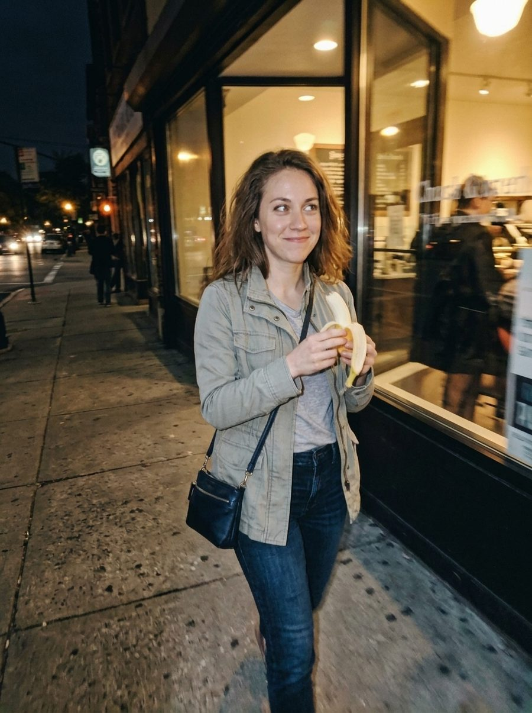

<p align="center">
  
</p>

<h1 align="center">nano-banana</h1>

<p align="center">
  <em>Des images depuis ton agent de code, avec la facture sous contrôle.</em>
</p>

<p align="center">
  <a href="https://github.com/jakubcurik/nano-banana/actions/workflows/tests.yml"></a>
  <a href="https://github.com/jakubcurik/nano-banana/actions/workflows/validate.yml"></a>
  <a href="https://github.com/jakubcurik/nano-banana/releases"></a>
  <a href="../LICENSE"></a>
  <a href="https://github.com/jakubcurik/nano-banana/stargazers"></a>
</p>

<p align="center">
  
  <a href="https://agentskills.io"></a>
  
  
</p>

<p align="center">
  <a href="#install">Installation</a> &middot;
  <a href="#quick-start">Démarrage rapide</a> &middot;
  <a href="#gallery">Galerie</a> &middot;
  <a href="#how-it-works">Fonctionnement</a> &middot;
  <a href="#models-and-prices">Modèles et prix</a> &middot;
  <a href="#faq">FAQ</a>
</p>

<p align="center">
  <sub><a href="../README.md">English</a> &middot;
  <a href="README.zh-CN.md">简体中文</a> &middot;
  <a href="README.es.md">Español</a> &middot;
  <a href="README.ja.md">日本語</a> &middot;
  <a href="README.pt-BR.md">Português (Brasil)</a> &middot;
  <a href="README.de.md">Deutsch</a> &middot;
  Français &middot;
  <a href="README.ko.md">한국어</a> &middot;
  <a href="README.cs.md">Čeština</a></sub>
</p>

<p align="center">
  
</p>

nano-banana est un skill d'agent qui permet à Claude Code et à d'autres agents de code de créer et de modifier des images avec les modèles Nano Banana de Google. Il garde aussi un œil sur ce que ça coûte.

Si tu demandes une image d'en-tête à un agent, tu l'obtiens. Si tu lui demandes d'« essayer encore quelques variantes », un simple appel d'API peut lancer une douzaine de générations en 4K pendant que tu regardes encore la première. Chaque image est facturée, et rien dans le chat ne te dit combien.

Ce skill affiche le prix estimé avant chaque appel et le coût réel après. Il vérifie tes options par rapport à ce que le modèle choisi accepte : une mauvaise taille ou un niveau de réflexion non pris en charge échoue donc sur ta machine, et non côté API. Pour le reste, il donne à l'agent une routine courte : demander à quoi sert l'image, récupérer des photos de référence quand le sujet doit ressembler à quelque chose de réel, écrire le prompt en anglais et regarder le résultat avant de le déclarer terminé.

<sub>Projet non officiel, sans lien avec Google et non approuvé par Google. « Nano Banana » et « Gemini » sont les noms que Google donne à ses modèles d'image et à son API.</sub>

## Voir en action

<p align="center">
  
</p>

C'est une vraie exécution. Une image en 2K avec le modèle par défaut coûte environ cinq cents de dollar américain, et tu vois le montant avant l'appel puis une deuxième fois après.

<a id="gallery"></a>

## Galerie

À part le texte et la capture d'écran du terminal, toutes les images de ce README ont été créées avec le skill. Toutes les personnes, tous les lieux et tous les objets qui y figurent sont générés par IA. Les prompts se trouvent dans [`assets/prompts`](../assets/prompts).

<p align="center">
  
  
  
  <br>
  <sub><b>Photos façon smartphone.</b> Une banane scotchée sur le mur d'une galerie, attachée dans un caddie et bouclée dans un siège auto. Model 2.1, 2K, 3:4, environ 5 cents par image.</sub>
</p>

<p align="center">
  
  
  <br>
  <sub><b>Retouche avec <code>--image</code>.</b> Une photo au flash prise de nuit est devenue un après-midi ensoleillé. Tout est resté identique, sauf la lumière. Model 2.1, 1K, environ 3 cents.</sub>
</p>

<p align="center">
  
  <br>
  
  
  <br>
  <sub><b>Graphismes.</b> Une infographie et une affiche de texte avec Model Pro (2K, environ 13 cents pièce), et une illustration vectorielle plate avec Model 2.1 (2K, environ 5 cents).</sub>
</p>

<p align="center">
  
  
  <br>
  <sub><b>La même mascotte dans de nouvelles scènes</b> avec <code>--follow-up</code>. Model 2.1, 1K, environ 3 cents par image.</sub>
</p>

<a id="install"></a>

## Installation

Claude Code, depuis le marketplace de plugins :

```
/plugin marketplace add jakubcurik/nano-banana
/plugin install nano-banana@nano-banana
```

Tout agent qui lit les skills `SKILL.md`, via [`npx skills`](https://github.com/vercel-labs/skills) :

```bash
npx skills add jakubcurik/nano-banana
```

Ou copie `skills/nano-banana/` à la main dans le dossier de skills de ton agent, par exemple `~/.claude/skills/` pour Claude Code ou `~/.agents/skills/` pour Codex, Gemini CLI et Cursor.

Il te faut aussi :

- [`uv`](https://docs.astral.sh/uv/), qui récupère tout seul `google-genai` et Python 3.11+. Sans lui, installe Python 3.11+ et `pip install "google-genai>=3.6,<4"`.
- Une clé d'API Gemini de [Google AI Studio](https://aistudio.google.com/apikey), avec la facturation activée. Les modèles d'image n'ont pas d'offre gratuite.

Donne la clé au script par l'environnement, ou enregistre-la une fois en dehors de tout dépôt :

```bash
export GEMINI_API_KEY="your-key"
# or
mkdir -p ~/.config/nano-banana && printf '%s' "your-key" > ~/.config/nano-banana/api-key
```

<a id="quick-start"></a>

## Démarrage rapide

Demande à ton agent : « fais une image d'en-tête pour le site de mon café, en 16:9 », « retire la voiture de cette photo », « combine ces deux photos ». Le skill se déclenche tout seul. Il demande à quoi sert l'image, écrit le prompt, t'indique le prix quand il n'est pas négligeable, lance le script et vérifie le résultat.

Tu peux aussi appeler le script toi-même :

```bash
S=skills/nano-banana/scripts/generate.py

uv run --script $S "A flat illustration of a red apple on a white table" --estimate
uv run --script $S "A flat illustration of a red apple on a white table" -a 16:9 -s 2K --format jpeg
uv run --script $S "Make the apple green. Keep everything else the same." --follow-up
uv run --script $S "Put this product on a marble table" -i product.jpg -m pro -s 2K
uv run --script $S "A banner with the text \"Open daily\"" --batch -n 4 --currency EUR
```

Les images sont enregistrées dans `.cache/nano-banana/`, chacune à côté d'un fichier `.txt` contenant le prompt, les options et l'ID d'interaction.

<details>
<summary>Toutes les options</summary>

| Option | Signification |
|---|---|
| `-m 2.1 / 2 / pro / lite` | modèle, `2.1` par défaut |
| `-s 512 / 1K / 2K / 4K` | résolution, `1K` par défaut (512 uniquement sur le modèle `2`) |
| `-a 16:9` | format d'image : 1:1, 2:3, 3:2, 3:4, 4:3, 4:5, 5:4, 9:16, 16:9, 21:9 ; aussi 1:4, 4:1, 1:8, 8:1 sur 2.1 et 2 |
| `-i photo.jpg` | image d'entrée pour une modification ou comme référence, répétable, 14 maximum |
| `-t minimal / medium / high` | niveau de réflexion, selon le modèle |
| `--search` | ancrage dans Google Search, y compris la recherche d'images (pas sur `lite`) |
| `--follow-up [ID]` | continuer à partir du dernier résultat, ou d'une interaction donnée |
| `-n 4` | nombre d'images, chacune facturée séparément |
| `-o folder` | dossier de sortie |
| `--format png / jpeg` | format du fichier de sortie |
| `--prompt-file file` | lire le prompt depuis un fichier |
| `--no-store` | demander à Google de ne pas conserver l'interaction (on ne peut alors plus la poursuivre avec un suivi) |
| `--batch` | moitié prix, jusqu'à 24 h (modèles 2.1 et lite) |
| `--estimate` | afficher l'estimation du prix et s'arrêter |
| `--currency CZK` | afficher aussi les prix dans cette devise (taux de la Banque nationale tchèque) |

</details>

<a id="how-it-works"></a>

## Fonctionnement

Le skill fait travailler l'agent dans un ordre précis. Il demande d'abord à quoi sert l'image. Si elle doit montrer une espèce, un produit ou un lieu réels, il trouve deux ou trois photos de référence et te les fait confirmer. Il écrit ensuite le prompt en anglais et estime le prix ; au-delà d'environ 0,50 USD, ou pour plus de quatre images, il te demande avant. Après la génération, il regarde le résultat et corrige les détails par un suivi plutôt que de tout recommencer.

Le workflow complet est dans [`SKILL.md`](../skills/nano-banana/SKILL.md). Les modèles de prompts, les modèles de modifications et une liste d'erreurs courantes se trouvent dans [`references/prompting.md`](../skills/nano-banana/references/prompting.md).

<a id="models-and-prices"></a>

## Modèles et prix

État au 26 novembre 2026, en USD par image.

| Modèle | Idéal pour | 1K | 2K | 4K |
|---|---|---|---|---|
| `2.1` (`gemini-nano-banana-2.1`) | presque tout | 0,034 | 0,050 | 0,113 |
| `2` (`gemini-3.1-flash-image`) | 512 px ; déprécié par Google, pas encore de date d'arrêt | 0,067 | 0,101 | 0,151 |
| `pro` (`gemini-3-pro-image`) | les prompts les plus difficiles, beaucoup de texte | 0,134 | 0,134 | 0,240 |
| `lite` (`gemini-3.1-flash-lite-image`) | beaucoup d'images simples, 1K uniquement, sans recherche | 0,034 | n/a | n/a |

Les prix et les données des modèles sont dans [`models.json`](../skills/nano-banana/scripts/models.json), le seul fichier à modifier quand Google change sa [grille tarifaire](https://ai.google.dev/gemini-api/docs/pricing). `--search` est facturé en plus : 5 000 prompts avec ancrage par mois sont gratuits, puis 14 USD pour 1 000 requêtes de recherche.

## À savoir

- Google stocke les interactions pour que les suivis fonctionnent : 55 jours sur les projets payants, 1 jour avec l'offre gratuite. Utilise `--no-store` pour les photos sensibles.
- Chaque image générée porte un filigrane invisible SynthID.
- Le modèle invente des détails. Quand une image doit correspondre à une espèce, un produit ou un bâtiment réel, donne-lui 2-3 photos de référence avec `-i`. Le workflow du skill y tient.
- Une requête qui expire a pu être facturée quand même, c'est pourquoi le script ne réessaie jamais de lui-même.
- Si tu publies un résultat obtenu avec `--search`, Google exige d'afficher ses suggestions de recherche. Le script les enregistre à côté de l'image.

<a id="faq"></a>

## FAQ

**Google a son propre CLI `gemini-api`. Pourquoi utiliser celui-ci ?**
Le CLI fait l'appel, et il le fait bien. Ce skill ajoute ce qui entoure l'appel. Tu peux vouloir les deux.

| | CLI et skills Google `gemini-api` | nano-banana |
|---|---|---|
| Estimation du prix avant, coût réel après | non | oui |
| L'agent demande avant les exécutions coûteuses | non | oui |
| Options vérifiées par rapport au modèle | non, l'API les rejette | oui |
| Modifications de suivi sans recopier d'ID | manuel | `--follow-up` |
| Prompt et options enregistrés à côté de chaque image | non | oui |
| Guide de prompting et modèles | non | oui |

Le CLI est en bêta et évolue vite, vérifie donc les deux avant de choisir.

**Est-ce que ça marche en dehors de Claude Code ?**
Le skill suit le format ouvert [Agent Skills](https://agentskills.io), donc les autres agents qui chargent des fichiers `SKILL.md` peuvent l'utiliser. Je ne l'ai testé que dans Claude Code.

**Les prix ont changé. Que dois-je modifier ?**
`skills/nano-banana/scripts/models.json`, ainsi que les tableaux de `SKILL.md` et d'ici.

**Pourquoi demande-t-il des photos de référence ?**
Sans photo, le modèle comble les détails d'un objet réel avec son imagination, et le résultat paraît plausible mais faux.

## Contribuer

Les issues et les pull requests sont les bienvenues, surtout quand Google change les modèles, les prix ou l'API. Mets à jour `models.json` et les tableaux de `SKILL.md` et de ce README en même temps.

Cette traduction a été réalisée avec l'aide de l'IA, et les corrections sont les bienvenues.

Les tests hors ligne n'ont besoin ni de clé d'API ni de réseau :

```bash
python -m unittest discover -s tests
```

## Licence

[MIT](../LICENSE)
