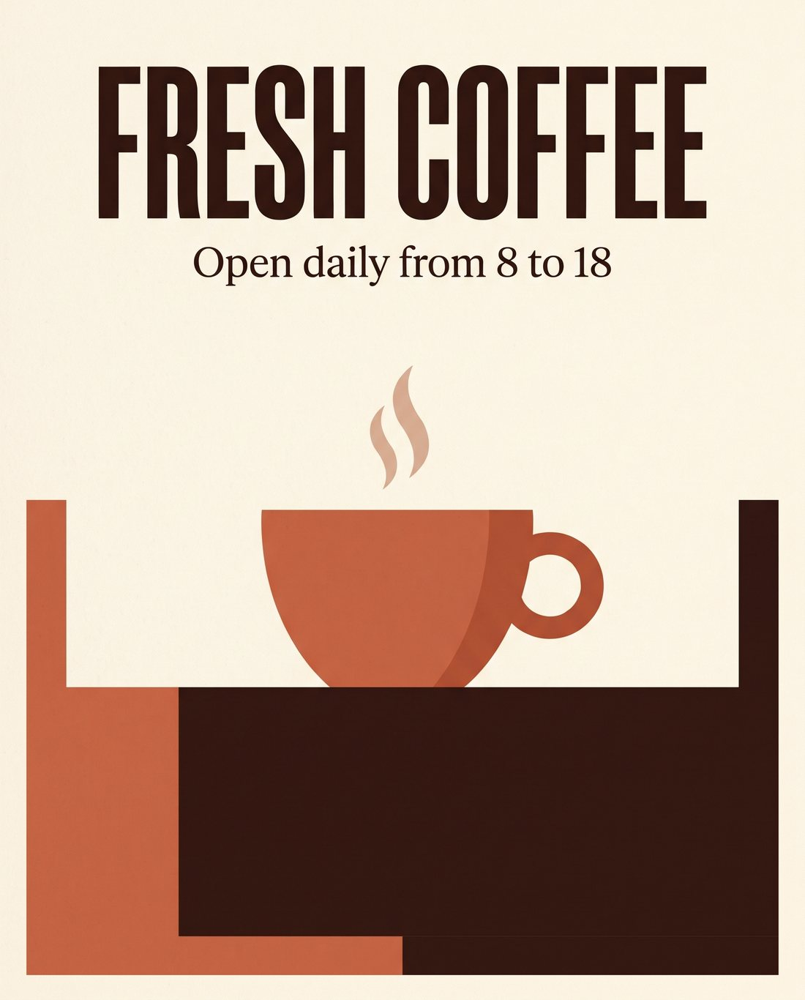

<p align="center">
  
</p>

<h1 align="center">nano-banana</h1>

<p align="center">
  <em>Imagens do seu agente de programação, com a conta sob controle.</em>
</p>

<p align="center">
  <a href="https://github.com/jakubcurik/nano-banana/actions/workflows/tests.yml"></a>
  <a href="https://github.com/jakubcurik/nano-banana/actions/workflows/validate.yml"></a>
  <a href="https://github.com/jakubcurik/nano-banana/releases"></a>
  <a href="../LICENSE"></a>
  <a href="https://github.com/jakubcurik/nano-banana/stargazers"></a>
</p>

<p align="center">
  
  <a href="https://agentskills.io"></a>
  
  
</p>

<p align="center">
  <a href="#install">Instalação</a> &middot;
  <a href="#quick-start">Início rápido</a> &middot;
  <a href="#gallery">Galeria</a> &middot;
  <a href="#how-it-works">Como funciona</a> &middot;
  <a href="#models-and-prices">Modelos e preços</a> &middot;
  <a href="#faq">Perguntas frequentes</a>
</p>

<p align="center">
  <sub><a href="../README.md">English</a> &middot;
  <a href="README.zh-CN.md">简体中文</a> &middot;
  <a href="README.es.md">Español</a> &middot;
  <a href="README.ja.md">日本語</a> &middot;
  Português (Brasil) &middot;
  <a href="README.de.md">Deutsch</a> &middot;
  <a href="README.fr.md">Français</a> &middot;
  <a href="README.ko.md">한국어</a> &middot;
  <a href="README.cs.md">Čeština</a></sub>
</p>

<p align="center">
  
</p>

O nano-banana é uma skill de agente que permite ao Claude Code e a outros agentes de programação criar e editar imagens com os modelos Nano Banana, do Google. Ela também acompanha quanto isso custa.

Peça uma imagem de destaque a um agente e você recebe uma. Peça para "tentar mais algumas variações" e uma chamada simples à API pode rodar uma dúzia de gerações em 4K enquanto você ainda está olhando para a primeira. Cada imagem é cobrada, e nada no chat mostra quanto.

Esta skill mostra o preço estimado antes de cada chamada e o custo real depois dela. Ela confere as suas opções com o que o modelo escolhido suporta, então um tamanho errado ou um nível de raciocínio não suportado falha na sua máquina e não na API. No resto, ela dá ao agente uma rotina curta: perguntar para que serve a imagem, buscar fotos de referência quando o assunto precisa parecer algo real, escrever o prompt em inglês e olhar o resultado antes de dá-lo como pronto.

<sub>Não oficial. Sem afiliação com o Google nem aprovação dele. "Nano Banana" e "Gemini" são os nomes que o Google dá aos seus modelos de imagem e à sua API.</sub>

## Veja funcionando

<p align="center">
  
</p>

Essa é uma execução real. Uma imagem em 2K no modelo padrão custa cerca de cinco centavos de dólar, e você vê o valor antes da chamada e de novo depois dela.

<a id="gallery"></a>

## Galeria

Além do texto e da captura de tela do terminal, todas as imagens deste README foram feitas com a skill. Os prompts estão em [`assets/prompts`](../assets/prompts).

<p align="center">
  
  <br>
  <sub><b>Texto para imagem.</b> Modelo 2.1, 2K, 16:9, cerca de 5 centavos.</sub>
</p>

<p align="center">
  
  
  <br>
  <sub><b>Edição com <code>--follow-up</code>.</b> A mesma caneca, uma nova cena. Modelo 2.1, 2K, cerca de 5 centavos por imagem.</sub>
</p>

<p align="center">
  
  <br>
  <sub><b>Texto dentro da imagem.</b> Modelo Pro, 2K, 4:5, cerca de 13 centavos.</sub>
</p>

<a id="install"></a>

## Instalação

Claude Code, pelo marketplace de plugins:

```
/plugin marketplace add jakubcurik/nano-banana
/plugin install nano-banana@nano-banana
```

Qualquer agente que leia skills em `SKILL.md`, com o [`npx skills`](https://github.com/vercel-labs/skills):

```bash
npx skills add jakubcurik/nano-banana
```

Ou copie `skills/nano-banana/` manualmente para a pasta de skills do seu agente, por exemplo `~/.claude/skills/` no Claude Code ou `~/.agents/skills/` no Codex, no Gemini CLI e no Cursor.

Você também precisa de:

- [`uv`](https://docs.astral.sh/uv/), que baixa o `google-genai` e o Python 3.11+ sozinho. Sem ele, instale o Python 3.11+ e rode `pip install "google-genai>=3.6,<4"`.
- Uma chave da Gemini API do [Google AI Studio](https://aistudio.google.com/apikey), com o faturamento ativado. Os modelos de imagem não têm nível gratuito.

Passe a chave ao script por variável de ambiente ou salve-a uma vez fora de qualquer repositório:

```bash
export GEMINI_API_KEY="your-key"
# or
mkdir -p ~/.config/nano-banana && printf '%s' "your-key" > ~/.config/nano-banana/api-key
```

<a id="quick-start"></a>

## Início rápido

Peça ao seu agente: "faça uma imagem de destaque para o site da minha cafeteria, 16:9", "tire o carro desta foto", "combine estas duas fotos". A skill é acionada sozinha. Ela pergunta para que serve a imagem, escreve o prompt, informa o preço quando ele não é trivial, executa o script e confere o resultado.

Você também pode chamar o script diretamente:

```bash
S=skills/nano-banana/scripts/generate.py

uv run --script $S "A flat illustration of a red apple on a white table" --estimate
uv run --script $S "A flat illustration of a red apple on a white table" -a 16:9 -s 2K --format jpeg
uv run --script $S "Make the apple green. Keep everything else the same." --follow-up
uv run --script $S "Put this product on a marble table" -i product.jpg -m pro -s 2K
uv run --script $S "A banner with the text \"Open daily\"" --batch -n 4 --currency EUR
```

As imagens vão para `.cache/nano-banana/`, cada uma ao lado de um arquivo `.txt` com o prompt, as opções e o ID da interação.

<details>
<summary>Todas as opções</summary>

| Opção | Significado |
|---|---|
| `-m 2.1 / 2 / pro / lite` | modelo, padrão `2.1` |
| `-s 512 / 1K / 2K / 4K` | resolução, padrão `1K` (512 só no modelo `2`) |
| `-a 16:9` | proporção: 1:1, 2:3, 3:2, 3:4, 4:3, 4:5, 5:4, 9:16, 16:9, 21:9; também 1:4, 4:1, 1:8, 8:1 no 2.1 e no 2 |
| `-i photo.jpg` | imagem de entrada para editar ou como referência, repetível, no máximo 14 |
| `-t minimal / medium / high` | nível de raciocínio, depende do modelo |
| `--search` | embasamento com a Pesquisa Google, incluindo busca de imagens (não no `lite`) |
| `--follow-up [ID]` | continua a partir do último resultado ou de uma interação específica |
| `-n 4` | número de imagens, cada uma cobrada separadamente |
| `-o folder` | pasta de saída |
| `--format png / jpeg` | formato do arquivo de saída |
| `--prompt-file file` | lê o prompt de um arquivo |
| `--no-store` | pede ao Google que não guarde a interação (isso desativa as continuações dela) |
| `--batch` | metade do preço, até 24 h (modelos 2.1 e lite) |
| `--estimate` | mostra a estimativa de preço e para |
| `--currency CZK` | mostra também os preços nessa moeda (cotação do Banco Nacional Tcheco) |

</details>

<a id="how-it-works"></a>

## Como funciona

O skill faz o agente trabalhar numa ordem fixa. Primeiro ele pergunta para que serve a imagem. Se ela precisa mostrar uma espécie, um produto ou um lugar reais, ele busca duas ou três fotos de referência e pede que você as confirme. Depois escreve o prompt em inglês e estima o preço; se passar de cerca de 0,50 USD ou se forem mais de quatro imagens, ele pergunta antes. Depois de gerar, olha o resultado e corrige detalhes com um follow-up, em vez de recomeçar do zero.

O fluxo completo está no [`SKILL.md`](../skills/nano-banana/SKILL.md). Modelos de prompt, modelos de edição e uma lista de erros comuns estão em [`references/prompting.md`](../skills/nano-banana/references/prompting.md).

<a id="models-and-prices"></a>

## Modelos e preços

Valores de 26 de novembro de 2026, em USD por imagem.

| Modelo | Melhor para | 1K | 2K | 4K |
|---|---|---|---|---|
| `2.1` (`gemini-nano-banana-2.1`) | quase tudo | 0,034 | 0,050 | 0,113 |
| `2` (`gemini-3.1-flash-image`) | 512 px; descontinuado pelo Google, ainda sem data de encerramento | 0,067 | 0,101 | 0,151 |
| `pro` (`gemini-3-pro-image`) | os prompts mais difíceis, muito texto | 0,134 | 0,134 | 0,240 |
| `lite` (`gemini-3.1-flash-lite-image`) | muitas imagens simples, só 1K, sem busca | 0,034 | n/a | n/a |

Os preços e os dados dos modelos ficam em [`models.json`](../skills/nano-banana/scripts/models.json), o único arquivo que você precisa editar quando o Google muda a [tabela de preços](https://ai.google.dev/gemini-api/docs/pricing). O `--search` é cobrado à parte: 5.000 prompts com embasamento por mês são gratuitos, depois disso são 14 USD por 1.000 consultas de pesquisa.

## Bom saber

- O Google guarda as interações para que as continuações funcionem: 55 dias em projetos pagos, 1 dia no nível gratuito. Use `--no-store` para fotos sensíveis.
- Toda imagem gerada leva uma marca d'água invisível SynthID.
- O modelo inventa detalhes. Quando uma imagem precisa corresponder a uma espécie, um produto ou um prédio reais, passe 2-3 fotos de referência com `-i`. O fluxo da skill insiste nisso.
- Uma requisição que deu timeout ainda pode ter sido cobrada, por isso o script nunca tenta de novo por conta própria.
- Se você publicar uma saída feita com `--search`, o Google exige que as sugestões de pesquisa sejam exibidas. O script as salva ao lado da imagem.

<a id="faq"></a>

## Perguntas frequentes

**O Google tem a própria CLI `gemini-api`. Por que usar esta?**
A CLI faz a chamada, e faz isso bem. Esta skill acrescenta o que fica em volta da chamada. Você pode querer as duas.

| | CLI e skills `gemini-api` do Google | nano-banana |
|---|---|---|
| Estimativa de preço antes, custo real depois | não | sim |
| O agente pergunta antes de execuções caras | não | sim |
| Opções conferidas com o modelo | não, a API as rejeita | sim |
| Edições de continuação sem copiar IDs | manual | `--follow-up` |
| Prompt e opções salvos ao lado de cada imagem | não | sim |
| Guia de prompts e modelos | não | sim |

A CLI está em beta e muda rápido, então confira as duas antes de escolher.

**Funciona fora do Claude Code?**
A skill segue o formato aberto [Agent Skills](https://agentskills.io), então outros agentes que carregam arquivos `SKILL.md` podem usá-la. Eu só testei no Claude Code.

**Os preços mudaram. O que eu edito?**
`skills/nano-banana/scripts/models.json`, e as tabelas do `SKILL.md` e deste README.

**Por que ela pede fotos de referência?**
Sem uma, o modelo preenche os detalhes de uma coisa real com a imaginação, e o resultado parece plausível e está errado.

## Contribuindo

Issues e pull requests são bem-vindos, principalmente quando o Google mudar modelos, preços ou a API. Atualize o `models.json` e as tabelas do `SKILL.md` e deste README juntos.

Esta tradução foi feita com a ajuda de IA, e correções são bem-vindas.

Os testes offline não precisam de chave de API nem de rede:

```bash
python -m unittest discover -s tests
```

## Licença

[MIT](../LICENSE)

## Histórico de estrelas

<a href="https://www.star-history.com/jakubcurik/nano-banana#history">
  <picture>
    <source media="(prefers-color-scheme: dark)" srcset="https://api.star-history.com/chart?repos=jakubcurik/nano-banana&type=Date&theme=dark" />
    <source media="(prefers-color-scheme: light)" srcset="https://api.star-history.com/chart?repos=jakubcurik/nano-banana&type=Date" />
    
  </picture>
</a>
