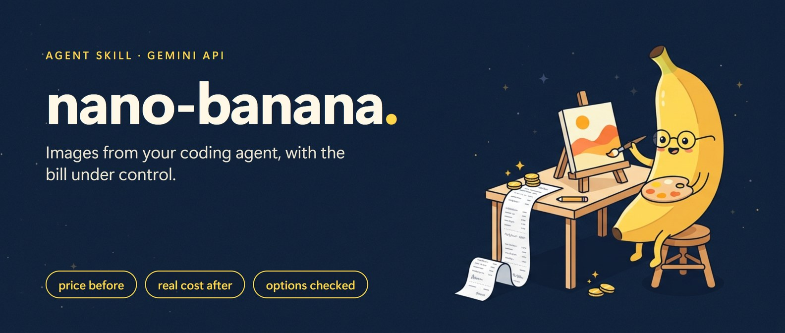
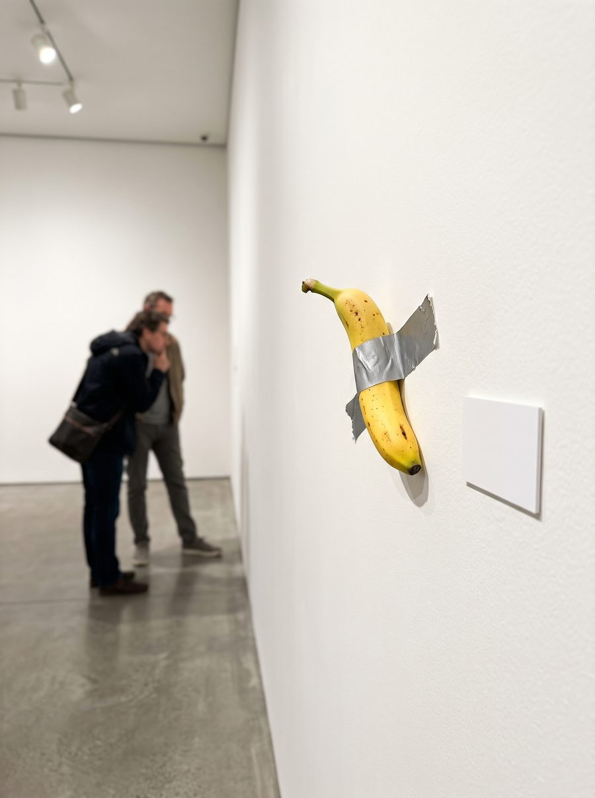
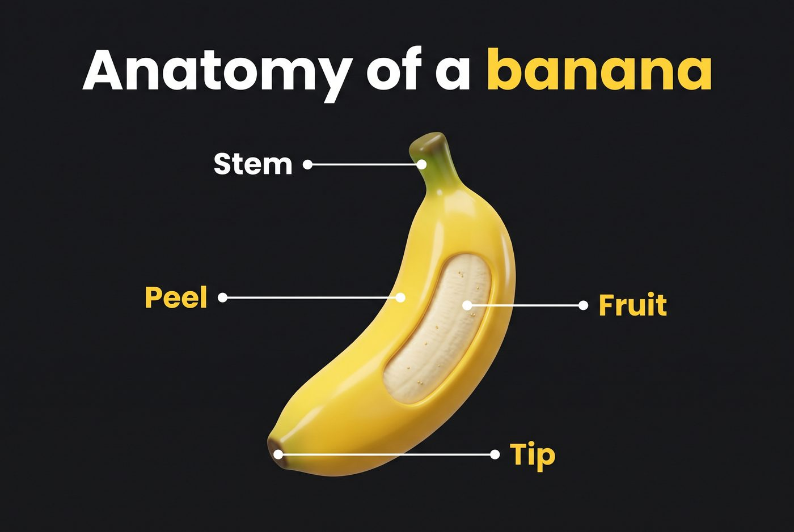

<p align="center">
  
</p>

<h1 align="center">nano-banana</h1>

<p align="center">
  <em>让编程 agent 帮你出图，费用心里有数。</em>
</p>

<p align="center">
  <a href="https://github.com/jakubcurik/nano-banana/actions/workflows/tests.yml"></a>
  <a href="https://github.com/jakubcurik/nano-banana/actions/workflows/validate.yml"></a>
  <a href="https://github.com/jakubcurik/nano-banana/releases"></a>
  <a href="../LICENSE"></a>
  <a href="https://github.com/jakubcurik/nano-banana/stargazers"></a>
</p>

<p align="center">
  
  <a href="https://agentskills.io"></a>
  
  
</p>

<p align="center">
  <a href="#install">安装</a> &middot;
  <a href="#quick-start">快速开始</a> &middot;
  <a href="#gallery">示例图库</a> &middot;
  <a href="#how-it-works">工作原理</a> &middot;
  <a href="#models-and-prices">模型与价格</a> &middot;
  <a href="#faq">常见问题</a>
</p>

<p align="center">
  <sub><a href="../README.md">English</a> &middot;
  简体中文 &middot;
  <a href="README.es.md">Español</a> &middot;
  <a href="README.ja.md">日本語</a> &middot;
  <a href="README.pt-BR.md">Português (Brasil)</a> &middot;
  <a href="README.de.md">Deutsch</a> &middot;
  <a href="README.fr.md">Français</a> &middot;
  <a href="README.ko.md">한국어</a> &middot;
  <a href="README.cs.md">Čeština</a></sub>
</p>

<p align="center">
  
</p>

nano-banana 是一个 agent skill，让 Claude Code 和其他编程 agent 可以用 Google 的 Nano Banana 模型生成和编辑图片，同时帮你记录花了多少钱。

让 agent 做一张首图，它就会给你一张。但如果你说“再多试几个版本”，直接调用 API 可能在你还在看第一张图时，就已经跑完十几张 4K 图。每张图都要付费，而聊天窗口里完全看不出花了多少。

这个 skill 会在每次调用前打印预估价格，调用后打印实际费用。它还会对照所选模型支持的范围检查你的选项，所以错误的尺寸或不支持的思考级别会在你本机就报错，而不是等到 API 才失败。除此之外，它给 agent 一套简短的流程：先问图片的用途；如果画面要像真实的东西，就先找参考照片；用英文写 prompt；最后看一眼结果再宣布完成。

<sub>非官方项目，与 Google 无关联，也未获得 Google 认可。“Nano Banana”和“Gemini”是 Google 对其图像模型和 API 的命名。</sub>

## 实际运行

<p align="center">
  
</p>

这是一次真实运行。在默认模型上生成一张 2K 图片大约要五美分，调用前后你都能看到这个数字。

<a id="gallery"></a>

## 示例图库

除了文字和终端截图，这份 README 里的所有图片都是用这个 skill 生成的。图中的每个人物、地点和物品都是 AI 生成的。提示词见 [`assets/prompts`](../assets/prompts)。

<p align="center">
  
  
  
  <br>
  <sub><b>手机拍摄风格的照片。</b>一根香蕉被胶带贴在画廊墙上、系在购物车里、扣在汽车座椅上。Model 2.1，2K，3:4，每张约 5 美分。</sub>
</p>

<p align="center">
  
  
  <br>
  <sub><b>用 <code>--image</code> 编辑。</b>一张夜间闪光灯拍的照片变成了阳光明媚的下午。除了光线，其他都没有变。Model 2.1，1K，约 3 美分。</sub>
</p>

<p align="center">
  
  <br>
  
  
  <br>
  <sub><b>图形。</b>一张信息图和一张文字海报用 Model Pro 生成（2K，每张约 13 美分），一张扁平矢量插画用 Model 2.1 生成（2K，约 5 美分）。</sub>
</p>

<p align="center">
  
  
  <br>
  <sub><b>同一个吉祥物，不同的场景</b>，用 <code>--follow-up</code> 生成。Model 2.1，1K，每张约 3 美分。</sub>
</p>

<a id="install"></a>

## 安装

Claude Code，通过插件市场：

```
/plugin marketplace add jakubcurik/nano-banana
/plugin install nano-banana@nano-banana
```

任何能读取 `SKILL.md` skill 的 agent，通过 [`npx skills`](https://github.com/vercel-labs/skills)：

```bash
npx skills add jakubcurik/nano-banana
```

或者手动把 `skills/nano-banana/` 复制到 agent 的 skills 文件夹，例如 Claude Code 用 `~/.claude/skills/`，Codex、Gemini CLI 和 Cursor 用 `~/.agents/skills/`。

你还需要：

- [`uv`](https://docs.astral.sh/uv/)，它会自己下载 `google-genai` 和 Python 3.11+。没有它的话，请安装 Python 3.11+，再运行 `pip install "google-genai>=3.6,<4"`。
- 来自 [Google AI Studio](https://aistudio.google.com/apikey) 的 Gemini API 密钥，并开通计费。图像模型没有免费额度。

通过环境变量把密钥交给脚本，或者一次性保存到任何仓库之外：

```bash
export GEMINI_API_KEY="your-key"
# or
mkdir -p ~/.config/nano-banana && printf '%s' "your-key" > ~/.config/nano-banana/api-key
```

<a id="quick-start"></a>

## 快速开始

对 agent 说：“给我的咖啡店网站做一张首图，16:9”“把这张照片里的车去掉”“把这两张照片合成一张”。skill 会自动触发。它会问图片的用途，写好 prompt，在费用不低时告诉你价格，运行脚本，并检查结果。

你也可以自己调用脚本：

```bash
S=skills/nano-banana/scripts/generate.py

uv run --script $S "A flat illustration of a red apple on a white table" --estimate
uv run --script $S "A flat illustration of a red apple on a white table" -a 16:9 -s 2K --format jpeg
uv run --script $S "Make the apple green. Keep everything else the same." --follow-up
uv run --script $S "Put this product on a marble table" -i product.jpg -m pro -s 2K
uv run --script $S "A banner with the text \"Open daily\"" --batch -n 4 --currency EUR
```

图片保存在 `.cache/nano-banana/` 中，每张图旁边有一个 `.txt` 文件，记录 prompt、选项和交互 ID。

<details>
<summary>所有选项</summary>

| 选项 | 含义 |
|---|---|
| `-m 2.1 / 2 / pro / lite` | 模型，默认 `2.1` |
| `-s 512 / 1K / 2K / 4K` | 分辨率，默认 `1K`（512 仅限模型 `2`） |
| `-a 16:9` | 宽高比：1:1、2:3、3:2、3:4、4:3、4:5、5:4、9:16、16:9、21:9；2.1 和 2 还支持 1:4、4:1、1:8、8:1 |
| `-i photo.jpg` | 用于编辑或作为参考的输入图片，可重复使用，最多 14 张 |
| `-t minimal / medium / high` | 思考级别，取决于模型 |
| `--search` | 使用 Google 搜索辅助，包括图片搜索（`lite` 不支持） |
| `--follow-up [ID]` | 接着上一次的结果继续，或接着指定的交互继续 |
| `-n 4` | 图片数量，每张单独计费 |
| `-o folder` | 输出文件夹 |
| `--format png / jpeg` | 输出文件格式 |
| `--prompt-file file` | 从文件读取 prompt |
| `--no-store` | 请求 Google 不要保存这次交互（这样就无法对它使用 follow-up） |
| `--batch` | 半价，最长等待 24 小时（模型 2.1 和 lite） |
| `--estimate` | 打印价格预估后停止 |
| `--currency CZK` | 同时用该货币显示价格（汇率来自捷克国家银行） |

</details>

<a id="how-it-works"></a>

## 工作原理

这个 skill 让 agent 按固定顺序工作。它先问清楚图片的用途。如果图片要呈现真实存在的物种、产品或地点，它会找两三张参考照片，并请你确认。然后用英文写 prompt 并估算价格；如果估价超过约 0.50 美元，或要生成四张以上的图片，它会先问你。生成之后，它会查看结果，小问题用 follow-up 修改，而不是重新生成。

完整流程见 [`SKILL.md`](../skills/nano-banana/SKILL.md)。prompt 模板、编辑模板和常见错误清单在 [`references/prompting.md`](../skills/nano-banana/references/prompting.md)。

<a id="models-and-prices"></a>

## 模型与价格

数据截至 2026 年 11 月 26 日，单位为美元 / 张。

| 模型 | 最适合 | 1K | 2K | 4K |
|---|---|---|---|---|
| `2.1` (`gemini-nano-banana-2.1`) | 几乎所有场景 | 0.034 | 0.050 | 0.113 |
| `2` (`gemini-3.1-flash-image`) | 512 px；Google 已将其标为弃用，尚无停服日期 | 0.067 | 0.101 | 0.151 |
| `pro` (`gemini-3-pro-image`) | 最难的 prompt、大量文字 | 0.134 | 0.134 | 0.240 |
| `lite` (`gemini-3.1-flash-lite-image`) | 大量简单图片，仅 1K，不支持搜索 | 0.034 | n/a | n/a |

价格和模型数据都在 [`models.json`](../skills/nano-banana/scripts/models.json) 里，Google 调整[价目表](https://ai.google.dev/gemini-api/docs/pricing)时只需要改这一个文件。`--search` 另外计费：每月 5000 次带搜索的 prompt 免费，超出后每 1000 次搜索查询收费 14 美元。

## 注意事项

- Google 会保存交互记录，这样 follow-up 才能用：付费项目保存 55 天，免费额度保存 1 天。处理敏感照片时请使用 `--no-store`。
- 每张生成的图片都带有不可见的 SynthID 水印。
- 模型会编造细节。当图片需要与真实的物种、产品或建筑一致时，用 `-i` 给它 2-3 张参考照片。这个 skill 的流程就是坚持这么做。
- 超时的请求可能仍然已被计费，所以脚本从不自动重试。
- 如果你要发布用 `--search` 生成的内容，Google 要求展示它的搜索建议。脚本会把这些建议保存在图片旁边。

<a id="faq"></a>

## 常见问题

**Google 有自己的 `gemini-api` CLI，为什么还要用这个？**
CLI 负责发出调用，而且做得不错。这个 skill 补充的是调用前后的那部分事情。你可能两个都想用。

| | Google `gemini-api` CLI 和 skills | nano-banana |
|---|---|---|
| 调用前预估价格，调用后显示实际费用 | 否 | 是 |
| 高价运行前 agent 会先询问 | 否 | 是 |
| 按模型检查选项 | 否，由 API 拒绝 | 是 |
| 后续编辑无需复制 ID | 手动 | `--follow-up` |
| 每张图旁边保存 prompt 和选项 | 否 | 是 |
| prompt 指南和模板 | 否 | 是 |

CLI 还是 beta 版，变化很快，所以选之前请两个都看一下。

**在 Claude Code 之外能用吗？**
这个 skill 遵循开放的 [Agent Skills](https://agentskills.io) 格式，所以其他能加载 `SKILL.md` 文件的 agent 也可以使用。我只在 Claude Code 里测试过。

**价格变了，要改哪里？**
改 `skills/nano-banana/scripts/models.json`，以及 `SKILL.md` 和这里的表格。

**为什么它要问参考照片？**
没有参考照片时，模型会凭想象补全真实事物的细节，结果看起来合理，实际上是错的。

## 参与贡献

欢迎提交 issue 和 pull request，尤其是在 Google 更改模型、价格或 API 的时候。请把 `models.json`、`SKILL.md` 里的表格和这份 README 一起更新。这份译文是在 AI 的帮助下完成的，欢迎指出并修正其中的错误。

离线测试不需要 API 密钥，也不需要联网：

```bash
python -m unittest discover -s tests
```

## 许可证

[MIT](../LICENSE)
